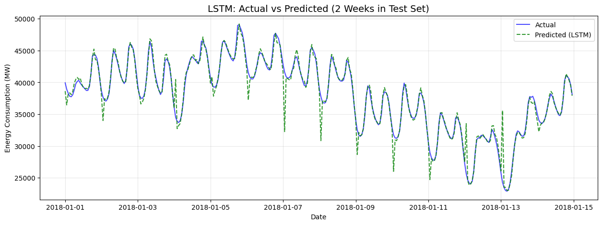
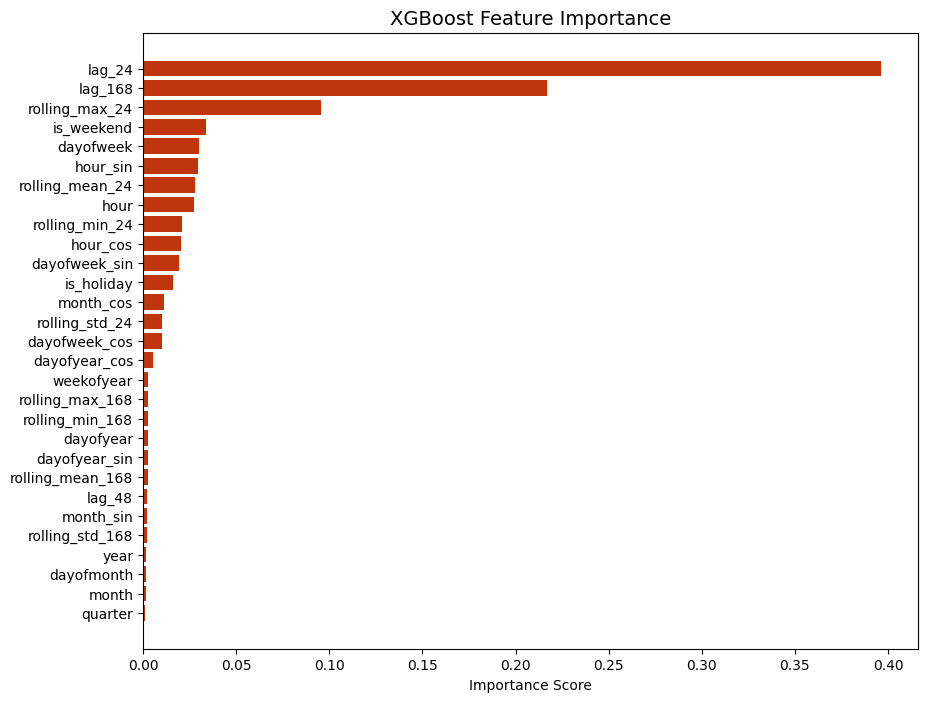

# ⚡ PJM Hourly Energy Consumption Forecasting


## 📖 Project Overview
This project presents a complete end-to-end time series forecasting pipeline designed to predict hourly energy consumption using the **PJM Interconnection (PJME)** dataset. It covers over 16 years of hourly electricity data (2002–2018) with 145,000+ records.

The primary objective was to accurately model complex daily and seasonal patterns while strictly preventing data leakage. Furthermore, the project benchmarks a traditional Machine Learning model (**XGBoost**) against two Deep Learning architectures (**LSTM** and **Transformer**) to determine the most effective approach for short-term energy forecasting.

## ⚙️ Methodology & Pipeline
1. **Advanced Feature Engineering:** 
   * Engineered calendar features using **Cyclical Encoding** (sine/cosine transformations) so the models understand that hour 23 is adjacent to hour 0.
   * Added autoregressive lags (24h, 48h, 168h) and rolling statistics (mean, std, max, min) using `shift(1)` to strictly prevent self-inclusion (Data Leakage).
2. **Strict Chronological Splitting:** Avoided random shuffling. Used a strict temporal split: 
   * **Train:** 2002–2014
   * **Validation:** 2015–2016
   * **Test:** 2017–2018
3. **Model Optimization:** 
   * **XGBoost:** Optimized using **Optuna** with `TimeSeriesSplit` cross-validation.
   * **Deep Learning (LSTM & Transformer):** Built sequential models using 24-hour sliding windows. Utilized **Keras Tuner (Hyperband)** for architecture optimization.

## 🏆 Results
The sequential nature of Deep Learning proved vastly superior to tree-based models for continuous forecasting. The LSTM emerged as the clear winner by successfully capturing sudden demand surges.

| Model | Architecture | Test MAE (MW) | Test MAPE |
| :--- | :--- | :--- | :--- |
| XGBoost | Tree-based (Optuna) | 1012.36 | 3.21% |
| Transformer | Self-Attention (Keras Tuner) | ~750.00 | ~2.10% |
| **LSTM (Winner)** | **Sequential (Keras Tuner)**| **372.89** | **1.26%** |

## 💡 Key Insights
* **The Power of Sequential Memory:** While tree-based models with manual lag features can capture general trends, they struggle with immediate short-term momentum and sudden unseasonal peaks. The LSTM model achieved a **60% reduction in MAE** and a **3x improvement in relative error (MAPE)** by naturally maintaining the chronological "memory" of the 24-hour sequence.
* **Cyclical Time Features:** Standard integer representations fail to capture the cyclical nature of time. Applying sine/cosine transformations allowed the models to mathematically understand that December is close to January.
* **Data Leakage Prevention:** Using `shift(1)` before calculating rolling statistics ensured the model never saw the current target value during training, resulting in highly realistic and unbiased test results.

### 📊 Visualizations



## 📂 Repository Structure
```text
├── notebooks/
│   └── pjm-energy-forecasting.ipynb    # Main Jupyter Notebook (EDA, XGBoost, LSTM, Transformer)
├── requirements.txt                    # Python dependencies
└── README.md                           # Project documentation
```

🚀 How to Run
Clone the repository:
git clone https://github.com/AliPakzad/PJM-Energy-Consumption-Forecasting.git

Install the required packages:
pip install -r requirements.txt

Open the Jupyter Notebook and run the cells:
jupyter notebook notebooks/pjm-energy-forecasting.ipynb

🔗 Links
Kaggle Notebook: [Insert your specific Kaggle Notebook Link Here]

LinkedIn: https://www.linkedin.com/in/ali-pakzad-b145a3b4

GitHub Profile: https://github.com/AliPakzad

Author: Ali Pakzad (Data Scientist & ML Engineer)
